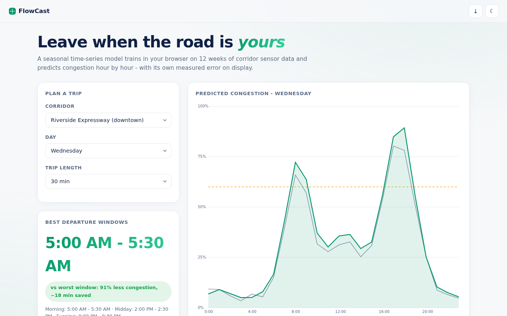
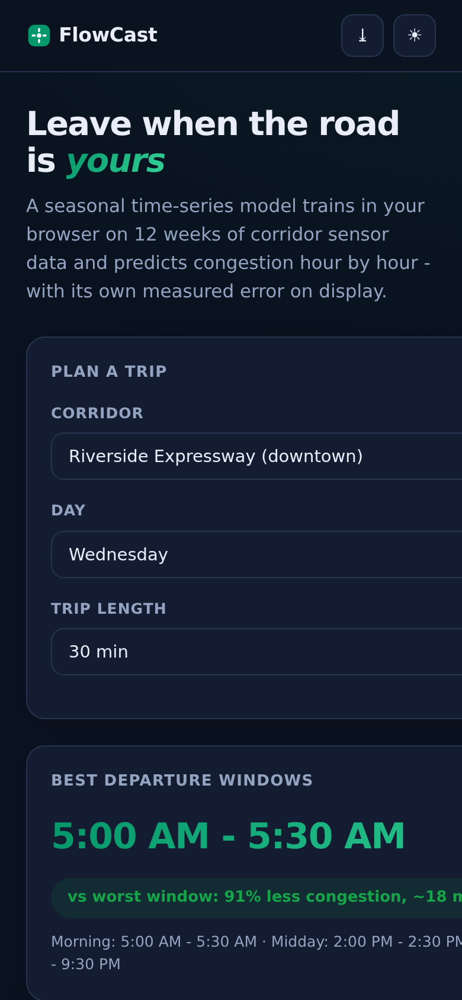

# FlowCast - Traffic Congestion Predictor

Hour-by-hour congestion forecasts with **best departure windows, a week heatmap, and the model's own measured error** - all computed in your browser.

**Live demo:** https://akash991833.github.io/traffic-prediction/

## Features

- **Seasonal time-series model** - per-(day, hour) seasonal profiles plus damped recent-trend correction, fit live on 12 weeks of sensor data per corridor
- **Best departure windows** - scans 15-minute steps to minimize congestion for your trip length; shows morning / midday / evening options plus time saved vs the worst window
- **Week heatmap** - 7 x 24 congestion grid with hover detail
- **Honest backtesting** - trains on 11 weeks, predicts the 12th, and reports the actual MAPE (not a cherry-picked number)
- **4 corridors** with distinct personalities: downtown expressway, tunnel, airport connector, university boulevard - including incidents and weather weeks
- **PWA** - installable, offline after first load
- **Premium UI** - white professional design, navy ink, emerald accent, dark + light themes, responsive desktop and mobile

## Screenshots




## Honest limits

Real sensor feeds require API keys, so the 12-week dataset is **simulated** with realistic rush-hour, weekend, incident, and rain patterns (labeled in-app). The forecasting and error measurement are fully real.

## Tech

Vanilla HTML/CSS/JS, canvas charts, zero dependencies.

## Run locally

Open `index.html` or serve the folder (`python3 -m http.server`).

---

## 🐍 Python version (real ML backend) - `python-app/`

The browser demo above is fully client-side. This folder is the **pro-grade version** with a real training pipeline on real data:

Predicts hourly I-94 traffic volume with XGBoost on 48,204 real observations (UCI). Time-based holdout: MAE 269 vehicles/h, R² 0.94. Stack: Python, Streamlit, XGBoost.

```bash
cd python-app
pip install -r requirements.txt
streamlit run app.py
```

Deploy free on **Hugging Face Spaces** (no card): create a Space, upload the `python-app/` folder - it ships Space-ready (`sdk` + `app_file` already set in its README). Retrain anytime with `python train.py` (where present).
